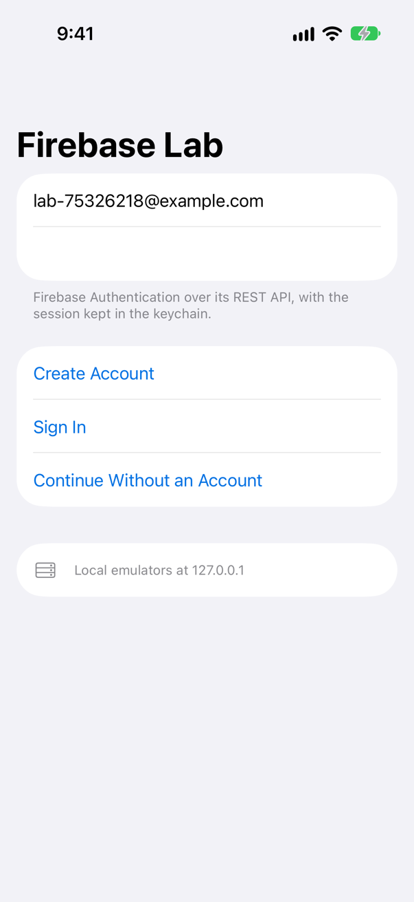
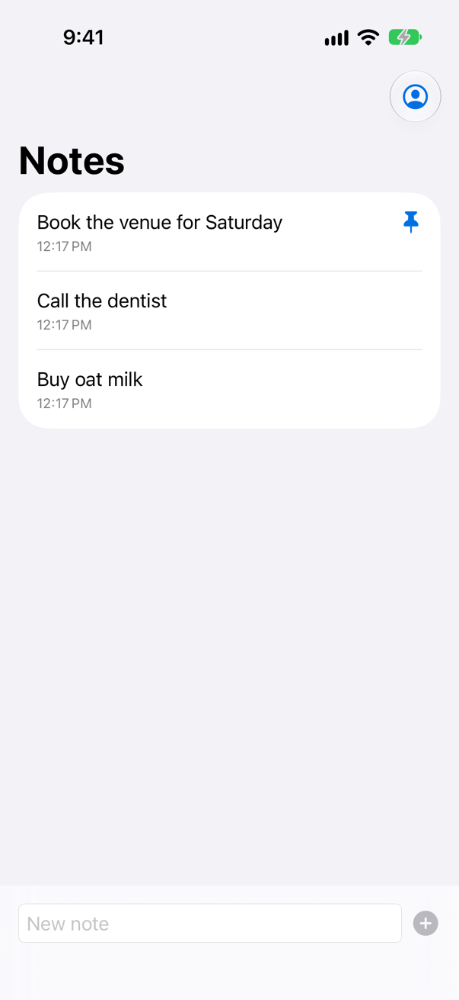
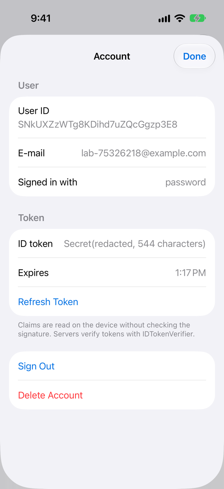
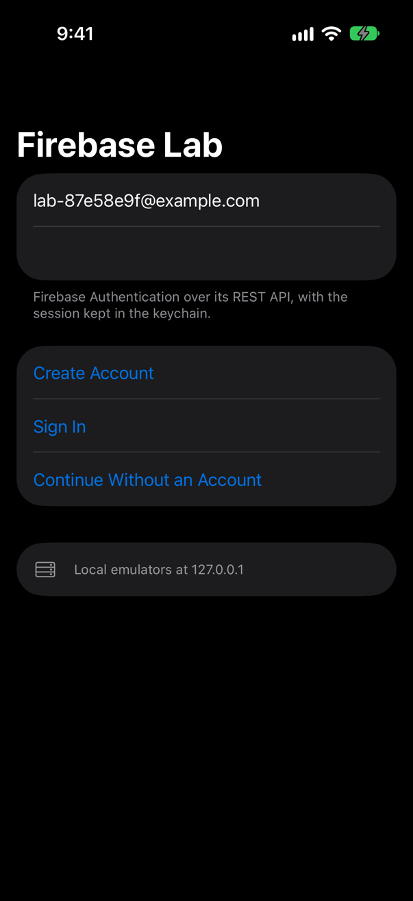
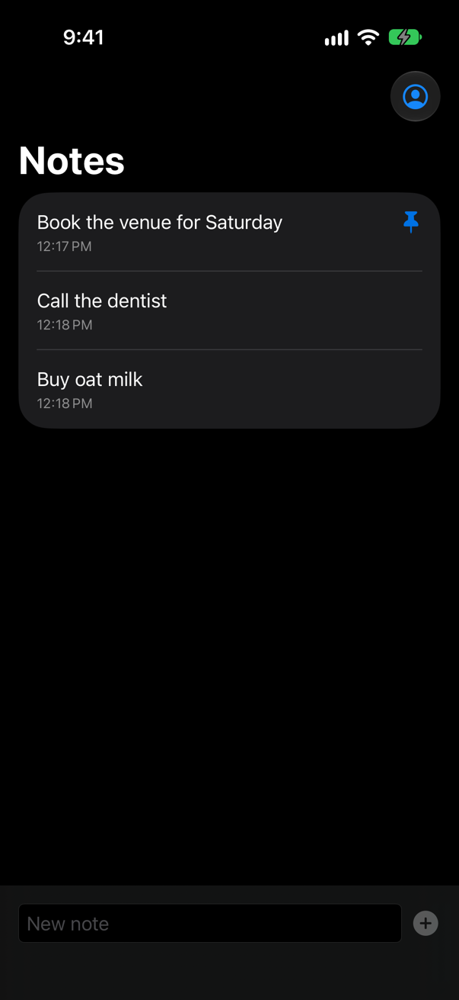
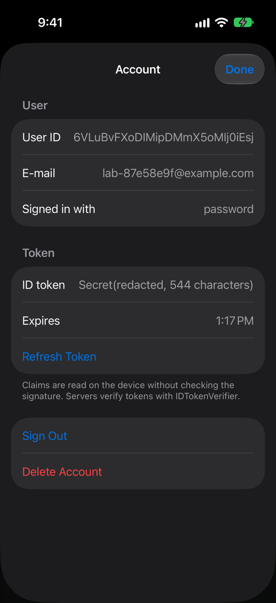

<!-- i18n-source: README.md@00e4a68870ee483107d14ea970068d1fcdd04d3c status=reviewed -->
<!-- brand:start -->

<p align="center"><picture><source media="(prefers-color-scheme: dark)" srcset="https://raw.githubusercontent.com/muhittincamdali/iOSFirebaseTools/master/.github/brand/banner-dark.svg"><source media="(prefers-color-scheme: light)" srcset="https://raw.githubusercontent.com/muhittincamdali/iOSFirebaseTools/master/.github/brand/banner-light.svg"></picture></p>

<!-- lang-selector:start -->
<p align="center"><a href="README.md">English</a> · <a href="README.tr.md">Türkçe</a> · <a href="README.zh-CN.md">简体中文</a> · <a href="README.ja.md">日本語</a> · <a href="README.ko.md">한국어</a> · <a href="README.es.md">Español</a> · <a href="README.de.md">Deutsch</a> · <a href="README.fr.md">Français</a> · <a href="README.pt-BR.md">Português (Brasil)</a> · <a href="README.ru.md">Русский</a></p>
<!-- lang-selector:end -->

<p align="center">
<a href="https://github.com/muhittincamdali/iOSFirebaseTools/actions/workflows/ci.yml"></a>
<a href="https://github.com/muhittincamdali/iOSFirebaseTools/releases"><picture><source media="(prefers-color-scheme: dark)" srcset="https://raw.githubusercontent.com/muhittincamdali/iOSFirebaseTools/master/.github/brand/badge-version-dark.svg"><source media="(prefers-color-scheme: light)" srcset="https://raw.githubusercontent.com/muhittincamdali/iOSFirebaseTools/master/.github/brand/badge-version-light.svg"></picture></a>
<a href="https://github.com/muhittincamdali/iOSFirebaseTools/blob/master/Package.swift"><picture><source media="(prefers-color-scheme: dark)" srcset="https://raw.githubusercontent.com/muhittincamdali/iOSFirebaseTools/master/.github/brand/badge-platforms-dark.svg"><source media="(prefers-color-scheme: light)" srcset="https://raw.githubusercontent.com/muhittincamdali/iOSFirebaseTools/master/.github/brand/badge-platforms-light.svg"></picture></a>
<a href="https://github.com/muhittincamdali/iOSFirebaseTools/blob/master/Package.swift"><picture><source media="(prefers-color-scheme: dark)" srcset="https://raw.githubusercontent.com/muhittincamdali/iOSFirebaseTools/master/.github/brand/badge-language-dark.svg"><source media="(prefers-color-scheme: light)" srcset="https://raw.githubusercontent.com/muhittincamdali/iOSFirebaseTools/master/.github/brand/badge-language-light.svg"></picture></a>
<a href="https://github.com/muhittincamdali/iOSFirebaseTools/blob/master/LICENSE"><picture><source media="(prefers-color-scheme: dark)" srcset="https://raw.githubusercontent.com/muhittincamdali/iOSFirebaseTools/master/.github/brand/badge-license-dark.svg"><source media="(prefers-color-scheme: light)" srcset="https://raw.githubusercontent.com/muhittincamdali/iOSFirebaseTools/master/.github/brand/badge-license-light.svg"></picture></a>
</p>

<p align="center">
<a href="#クイックスタート"><picture><source media="(prefers-color-scheme: dark)" srcset="https://raw.githubusercontent.com/muhittincamdali/iOSFirebaseTools/master/.github/brand/button-start-ja-dark.svg"><source media="(prefers-color-scheme: light)" srcset="https://raw.githubusercontent.com/muhittincamdali/iOSFirebaseTools/master/.github/brand/button-start-ja-light.svg"></picture></a>
<a href="https://muhittincamdali.github.io/iOSFirebaseTools/documentation/iosfirebasetools/"><picture><source media="(prefers-color-scheme: dark)" srcset="https://raw.githubusercontent.com/muhittincamdali/iOSFirebaseTools/master/.github/brand/button-docs-ja-dark.svg"><source media="(prefers-color-scheme: light)" srcset="https://raw.githubusercontent.com/muhittincamdali/iOSFirebaseTools/master/.github/brand/button-docs-ja-light.svg"></picture></a>
<a href="https://github.com/muhittincamdali/iOSFirebaseTools/tree/master/Examples"><picture><source media="(prefers-color-scheme: dark)" srcset="https://raw.githubusercontent.com/muhittincamdali/iOSFirebaseTools/master/.github/brand/button-examples-ja-dark.svg"><source media="(prefers-color-scheme: light)" srcset="https://raw.githubusercontent.com/muhittincamdali/iOSFirebaseTools/master/.github/brand/button-examples-ja-light.svg"></picture></a>
</p>

> このドキュメントは英語版 README の翻訳です。内容が異なる場合は英語版が最新です。

<!-- brand:end -->

iOSFirebaseTools は、Firebase Authentication と Cloud Firestore のための Swift パッケージです。Firebase SDK を組み込む代わりに、`URLSession` で Firebase の REST API と直接通信します。SDK が合わない、あるいは存在しない環境を想定しています。サイズやメモリの予算が厳しい App Clip やウィジェット、watchOS、コマンドラインツール、アプリが送ってくる ID トークンを検証する必要がある Swift サーバーなどです。ユーザーのサインインとトークンの更新を行い、`Codable` モデルを Firestore のドキュメントに対応付け、Firebase Local Emulator Suite に対して実行でき、サーバー上で ID トークンを検証します。Apple の SDK 以外に依存するものはありません。

## 主な特長

- **サインインしたままになる認証** — メールアドレスとパスワード、匿名、Sign in with Apple、Google に対応します。セッションはキーチェーンに保存され、ID トークンは有効期限が切れる前に更新されます。同時に呼び出す側がいくつあっても、リクエストは 1 回だけです。
- **自分の型で使える Firestore** — `Codable` モデルの読み取り、クエリ、書き込み、バッチ書き込み、トランザクションの実行ができます。`Date` はタイムスタンプになり、サーバータイムスタンプとインクリメントは引数 1 つで指定できます。
- **クラッシュではなくエラー** — `Int64` を超える整数、`Int` フィールドの NaN、10000 年の日付、20 MB のレスポンスは、型付きのエラーとして throw されます。パス、フィールド名、上限は、リクエストを送る前に Firebase のルールに照らして検査されます。
- **サーバーで ID トークンを検証** — `IDTokenVerifier` は、Google が公開している鍵を使って RS256 トークンに Firebase のルールを適用します。Admin SDK は他の言語向けにこれを提供していますが、Swift 向けにはありません。
- **秘密を含まないログ** — トークン、メールアドレス、リクエストボディ、クエリの値、ID に見えるパスの断片、サーバーのメッセージは、`print`、`dump`、ログ、デバッガーの表示に含まれません。[ログに表示される内容](#ログに表示される内容)を参照してください。
- **エンドツーエンドでテスト済み** — 142 件の Swift Testing テストがあり、そのうち 10 件は Security Rules 付きの Authentication と Firestore エミュレータに対して実行されます。さらに、サンプルアプリの UI テストがシミュレータ上で 5 件実行されます。

## クイックスタート

**1. パッケージを追加する**

Xcode で **File › Add Package Dependencies…** を選び、リポジトリの URL を入力します。

```text
https://github.com/muhittincamdali/iOSFirebaseTools.git
```

**2. モジュールをインポートする**

```swift
import iOSFirebaseTools
```

**3. 使ってみる**

プロジェクトの `GoogleService-Info.plist` をアプリのターゲットに追加し、**Anonymous** サインインを有効にして、[Firebase console](https://console.firebase.google.com) で Cloud Firestore データベースを作成します。ユーザーが自分のノートを書き込めるように、[Security Rules](Emulators/firestore.rules) も設定してください。そのうえで、新しい iOS アプリの `ContentView.swift` を次の内容に置き換えます。

```swift
import iOSFirebaseTools
import SwiftUI

struct ContentView: View {
    @State private var status = "Nothing saved yet"

    var body: some View {
        VStack(spacing: 16) {
            Text(status)
            Button("Save a note to Firestore") {
                Task { status = await saveFirstNote() }
            }
        }
        .padding()
    }
}

func saveFirstNote() async -> String {
    do {
        // Reads the GoogleService-Info.plist in your app target.
        let project = try GoogleServiceInfo.inMainBundle().project()
        let auth = FirebaseAuthClient(project: project)
        let firestore = FirestoreClient(project: project, credentials: .user(auth))

        let session = try await auth.signInAnonymously()
        let note = ["text": "Hello, Firestore", "ownerID": session.userID]
        let path = try await firestore.add(note, to: "notes")
        return "Saved \(path)"
    } catch {
        return "Could not save: \(error)"
    }
}
```

アプリを実行してボタンをタップすると、テキストが `Saved notes/…` と表示され、ノートがコンソールの **Firestore Database** に現れます。まだ Firebase プロジェクトがない場合でも、同じコードを Mac 上のエミュレータに対して実行できます。[エミュレータでテストする](#エミュレータでテストする)を参照してください。

## インストール

### Swift Package Manager

Xcode で **File › Add Package Dependencies…** を選び、リポジトリの URL を入力します。

```text
https://github.com/muhittincamdali/iOSFirebaseTools.git
```

または `Package.swift` の `dependencies` に追加します。

```swift
dependencies: [
    .package(url: "https://github.com/muhittincamdali/iOSFirebaseTools.git", from: "2.0.0")
],
targets: [
    .target(name: "YourApp", dependencies: [
        .product(name: "iOSFirebaseTools", package: "iOSFirebaseTools")
    ])
]
```

## 使い方

以下のサンプルは [`Examples/FirebaseLab/FirebaseLab/ReadmeSamples.swift`](Examples/FirebaseLab/FirebaseLab/ReadmeSamples.swift) からコピーしたものです。このファイルはサンプルアプリとパッケージのテストがコンパイルし、エミュレータのテストが実行します。

### クライアントを一度だけ設定する

```swift
func makeClients() throws -> (FirebaseAuthClient, FirestoreClient) {
    // The GoogleService-Info.plist you downloaded from the Firebase console.
    let project = try GoogleServiceInfo.inMainBundle().project()
    let auth = FirebaseAuthClient(project: project) // keeps the session in the keychain
    let firestore = FirestoreClient(project: project, credentials: .user(auth))
    return (auth, firestore)
}

func checkConfiguration() throws {
    let info = try GoogleServiceInfo.inMainBundle()
    for problem in info.problems(bundleIdentifier: Bundle.main.bundleIdentifier) {
        // For example: BUNDLE_ID is com.example.notes but the app is com.example.notes.dev
        assertionFailure(problem.description)
    }
}
```

### サインインする

```swift
func signIn(with auth: FirebaseAuthClient, email: String, password: String) async throws -> AuthSession {
    do {
        return try await auth.signIn(email: email, password: password)
    } catch let error as AuthError where error.code == .invalidLoginCredentials {
        print("Wrong e-mail or password")
        throw error
    } catch let error as AuthError where error.code == .tooManyAttempts {
        print("Too many attempts; try again later")
        throw error
    }
}

func currentUserID(with auth: FirebaseAuthClient) async throws -> String {
    // The session saved by an earlier launch, or a new anonymous user.
    if let session = try await auth.restoreSession() { return session.userID }
    return try await auth.signInAnonymously().userID
}
```

`auth.idToken()` は、あと 5 分以上有効なトークンを返します。必要であれば先に更新します。Sign in with Apple は `auth.signIn(with: .apple(idToken:rawNonce:))` で行い、nonce には `AppleSignInNonce` を使います。全体の流れは [Signing In](https://muhittincamdali.github.io/iOSFirebaseTools/documentation/iosfirebasetools/signingin) ガイドを参照してください。

### ドキュメントを読み書きする

```swift
struct Note: Codable, Sendable, Equatable {
    var text: String
    var ownerID: String
    var pinned = false
    var createdAt: Date? // set by the server
}

func addNote(_ text: String, ownerID: String, to firestore: FirestoreClient) async throws -> String {
    let note = Note(text: text, ownerID: ownerID)
    return try await firestore.add(note, to: "notes", transforms: ["createdAt": .serverTimestamp])
}

func loadNotes(ownerID: String, from firestore: FirestoreClient) async throws -> [FirestoreDocument<Note>] {
    let query = FirestoreQuery(collection: "notes")
        .filter("ownerID", .equal, ownerID)
        .limit(100)
    return try await firestore.documents(matching: query, as: Note.self)
}

func pinNote(at path: String, in firestore: FirestoreClient) async throws {
    try await firestore.update(path, fields: ["pinned": true])
}
```

### アトミックに書き込む

```swift
func moveNote(from oldPath: String, to newPath: String, in firestore: FirestoreClient) async throws {
    guard let note = try await firestore.document(oldPath, as: Note.self) else { return }
    var batch = WriteBatch() // both writes happen, or neither
    try batch.create(note.data, at: newPath)
    try batch.delete(oldPath)
    try await firestore.commit(batch)
}
```

### トランザクションで読み書きする

```swift
/// Flips `pinned` even when two devices tap at once: the read and the write happen together.
func togglePin(at path: String, in firestore: FirestoreClient) async throws -> Bool? {
    try await firestore.runTransaction { transaction in
        guard let note = try await transaction.document(path, as: Note.self) else { return nil }
        try transaction.update(path, fields: ["pinned": .bool(!note.data.pinned)])
        return !note.data.pinned
    }
}
```

読み取りからコミットまでの間に別の書き込みがそのノートを変更した場合、Firestore はコミットを中止し、クロージャが再実行されます。既定では最大 5 回です。

### サーバーでトークンを検証する

```swift
func userID(fromAuthorizationHeader header: String, verifier: IDTokenVerifier) async throws -> String {
    // let verifier = try IDTokenVerifier(projectID: "my-app-1a2b3"), created once
    guard header.hasPrefix("Bearer ") else { throw TokenError.malformed("no bearer token") }
    let claims = try await verifier.verify(String(header.dropFirst("Bearer ".count)))
    return claims.subject
}
```

### エミュレータでテストする

[Firebase CLI](https://firebase.google.com/docs/cli) で Authentication と Firestore のエミュレータを起動し（`firebase emulators:start --only auth,firestore --project demo-notes`、Java 21 以降が必要）、クライアントの接続先をそれらに向けます。`demo-` で始まるプロジェクト ID には Firebase アカウントは不要です。

```swift
func makeEmulatorClients() throws -> (FirebaseAuthClient, FirestoreClient) {
    // `firebase emulators:start --only auth,firestore --project demo-notes`
    let project = try FirebaseProject(projectID: "demo-notes", apiKey: "any-key")
        .usingEmulators(auth: "127.0.0.1:9099", firestore: "127.0.0.1:8080")
    let auth = FirebaseAuthClient(project: project)
    return (auth, FirestoreClient(project: project, credentials: .user(auth)))
}
```

エミュレータはプレーンな HTTP で応答するため、iOS アプリの Info.plist では `NSAppTransportSecurity` の下に `NSAllowsLocalNetworking` も必要です。ネットワークを使わないユニットテストでは、どのクライアントも差し替え可能な `HTTPTransport` を受け取れます。

## デモ

| サインイン                                              | Firestore のノート                                  | アカウントとトークン                                       |
| ------------------------------------------------------- | --------------------------------------------------- | ---------------------------------------------------------- |
|  |  |  |
|   |   |   |

スクリーンショットは、サンプルアプリの UI テストを iPhone シミュレータで実行して撮影したものです。[`scripts/capture-screenshots.sh`](scripts/capture-screenshots.sh) が Firebase Local Emulator Suite に対してテストを実行します。テストはサインアップし、ノートを 3 件書き込み、1 件をピン留めして（ピン留めしたノートが先頭に並びます）、アカウント画面を開きます。この画面では ID トークンは `Secret(redacted, … characters)` としてのみ表示されます。

自分で試すには、`scripts/start-emulators.sh` を実行し、[`Examples/FirebaseLab`](Examples/FirebaseLab) の `FirebaseLab.xcodeproj` を開いて、iPhone シミュレータを選び、**Run** を押します。詳しくは [Examples/README.md](Examples/README.md) を参照してください。[`Examples/ConfigCheck`](Examples/ConfigCheck) のコマンドラインツール `fbcheck` は、plist の検査とトークンの検証ができます。

## ログに表示される内容

このパッケージ内で、トークン、パスワード、個人データを保持しうるすべての値は、秘匿された形で出力されます。コードが完全には理解できないものは隠されます。

| 値                                     | 表示されるもの                                                         | 決して表示されないもの                                                |
| -------------------------------------- | ---------------------------------------------------------------------- | --------------------------------------------------------------------- |
| `Secret`                               | 長さ                                                                   | 値そのもの                                                            |
| `AuthSession`                          | ユーザー ID の先頭、匿名かどうか、有効期限                             | トークン、メールアドレス                                              |
| `HTTPRequest`, `HTTPResponse`          | メソッド、ホスト、パス、クエリ名、許可リストにあるヘッダー、ステータス | ボディ、ユーザー情報、フラグメント、クエリの値、ID に見えるパスの断片 |
| `AuthError`, `FirestoreError`          | コードと HTTP ステータス                                               | サーバーのメッセージ（コードで `message` を読んでください）           |
| `FirebaseProject`, `GoogleServiceInfo` | プロジェクト ID、データベース、バンドル ID                             | API キー                                                              |

```text
HTTPRequest(POST https://securetoken.googleapis.com/v1/token?key=<redacted>,
  headers: [authorization: <redacted>, content-type: application/x-www-form-urlencoded],
  body: [body omitted: 48 bytes, application/x-www-form-urlencoded])
```

名前は、パーセントデコード、NFKC 正規化、大文字小文字の畳み込みを行ってから比較されます。それでも通常の ASCII だけにならない名前、たとえば `şifre` や、キリル文字を含む `password` は、秘密として扱われます。ボディは解析も表示もされません。`RedactionPolicy` は、値を自分のログに表示してよいヘッダーとクエリパラメータを列挙します。

これは安全網であって、保証ではありません。自分で書いたテキストは秘匿できず、URL パスに含まれる短い秘密は普通の単語のように見えることがあります。そもそも秘密をログや URL に入れないでください。完全なルールと制限は [Logging and Redaction](https://muhittincamdali.github.io/iOSFirebaseTools/documentation/iosfirebasetools/loggingandredaction) の記事にあります。

## ドキュメント

API リファレンスと解説記事：

- [API リファレンス](https://muhittincamdali.github.io/iOSFirebaseTools/documentation/iosfirebasetools/)（DocC。`master` から GitHub Pages に公開されます）
- ローカルでは、Xcode の **Product › Build Documentation** か、コマンドラインでビルドできます。

```sh
xcodebuild docbuild -scheme iOSFirebaseTools -destination 'generic/platform=macOS'
```

## ガイド

- [Getting Started](https://muhittincamdali.github.io/iOSFirebaseTools/documentation/iosfirebasetools/gettingstarted) — パッケージの追加、Firebase プロジェクトの準備、サインイン、ドキュメントの保存（[ソース](Sources/iOSFirebaseTools/iOSFirebaseTools.docc/GettingStarted.md)）。
- [Signing In](https://muhittincamdali.github.io/iOSFirebaseTools/documentation/iosfirebasetools/signingin) — メール、匿名、Apple、Google でのサインイン、エラー、キーチェーンのセッション、最新のトークン（[ソース](Sources/iOSFirebaseTools/iOSFirebaseTools.docc/SigningIn.md)）。
- [Working with Firestore](https://muhittincamdali.github.io/iOSFirebaseTools/documentation/iosfirebasetools/workingwithfirestore) — モデル、クエリ、書き込み、トランスフォーム、バッチ、トランザクション、クライアントが検査する上限（[ソース](Sources/iOSFirebaseTools/iOSFirebaseTools.docc/WorkingWithFirestore.md)）。
- [Verifying ID Tokens](https://muhittincamdali.github.io/iOSFirebaseTools/documentation/iosfirebasetools/verifyingidtokens) — Swift サーバーでの Firebase のルール、鍵のキャッシュ、クレーム、時計のずれ（[ソース](Sources/iOSFirebaseTools/iOSFirebaseTools.docc/VerifyingIDTokens.md)）。
- [Testing with the Emulators](https://muhittincamdali.github.io/iOSFirebaseTools/documentation/iosfirebasetools/testingwiththeemulators) — Local Emulator Suite、`emulators:exec`、テスト用 transport を使ったユニットテスト（[ソース](Sources/iOSFirebaseTools/iOSFirebaseTools.docc/TestingWithTheEmulators.md)）。
- [Logging and Redaction](https://muhittincamdali.github.io/iOSFirebaseTools/documentation/iosfirebasetools/loggingandredaction) — リクエスト、セッション、エラーがログに何を表示するか、許可リスト、そして検出されないもの（[ソース](Sources/iOSFirebaseTools/iOSFirebaseTools.docc/LoggingAndRedaction.md)）。

## 動作要件

| プラットフォーム | 最小バージョン               |
| -------- | --------------------- |
| iOS      | 17                    |
| macOS    | 14                    |
| tvOS     | 17                    |
| watchOS  | 10                    |
| visionOS | 1                     |
| ツールチェーン  | Swift 6.2 · Xcode 26+ |

このパッケージは Security フレームワークと CryptoKit を使うため、Linux ではビルドできません。CI は GitHub の `macos-26` ランナーイメージに入っている既定の Xcode でビルドします。パッケージ自体は Xcode 27 で開発されています。エミュレータのテストには、Firebase CLI と Java 21 以降が必要です。

## アーキテクチャ

- `Project/`：`FirebaseProject`（プロジェクト ID、API キー、データベース、エミュレータ）と、plist を読み取って検査する `GoogleServiceInfo`。
- `Auth/`：Identity Toolkit と Secure Token の REST API を扱う actor の `FirebaseAuthClient`、`AuthSession` とその保存先の `SessionStore`（キーチェーンまたはメモリ）、各プロバイダーの認証情報。
- `Firestore/`：Firestore REST API を扱う `Sendable` な struct の `FirestoreClient`、JSON 形式を持つ `FirestoreValue`、`Codable` のエンコーダーとデコーダー、パス、クエリ、`WriteBatch` と `FirestoreTransaction`。書き込みはすべて `commit` エンドポイントを通るため、単独の書き込みも、バッチも、トランザクションも同じように動作します。
- `Tokens/`：`JSONWebToken` の解析、`IDTokenClaims`、Google の JSON Web Key Set にある RSA 鍵を使う `IDTokenVerifier`。
- `Transport/`：`HTTPTransport` プロトコルとその `URLSession` 実装。ネットワークに触れるのはここだけです。
- `Support/`：`Secret`、`ValidationError`、そしてあらゆるテキスト表現で共通に使われる秘匿ルール。
- プロセスの外から入る入力には上限があります。レスポンスボディ（16 MiB）、トークン（16 KiB）、plist（64 KiB）、ネストの深さ、変換前の数値の範囲、エミュレータのアドレス（`host:port` のみ）です。

テストをローカルで実行します。

```sh
swift test                                      # macOS, emulator suite skipped
firebase emulators:exec --config Emulators/firebase.json --project demo-iosfirebasetools 'swift test'
xcodebuild test -scheme iOSFirebaseTools -destination 'platform=iOS Simulator,name=iPhone 17 Pro'
```

## ロードマップ

- パッケージを Swift Package Index に追加する（`.spi.yml` はすでにリポジトリにあります）。
- 既存のユーザーへのプロバイダーのリンクと、メールアドレスの確認。
- swift-crypto 上で動く `IDTokenVerifier` の Linux 版。

リアルタイムリスナーとオフラインキャッシュは予定していません。どちらも Firestore の gRPC ストリーミング接続が必要で、REST API では提供されていないためです。

## コントリビューション

コントリビューションを歓迎します。pull request を作成する前に[コントリビューションガイド](https://github.com/muhittincamdali/iOSFirebaseTools/blob/master/CONTRIBUTING.md)と[行動規範](https://github.com/muhittincamdali/.github/blob/main/CODE_OF_CONDUCT.md)をお読みください。セキュリティ上の問題は[セキュリティポリシー](https://github.com/muhittincamdali/iOSFirebaseTools/blob/master/SECURITY.md)に従って非公開で報告してください。

## ライセンス

MIT ライセンスで公開しています。詳細は [LICENSE](LICENSE) を参照してください。
